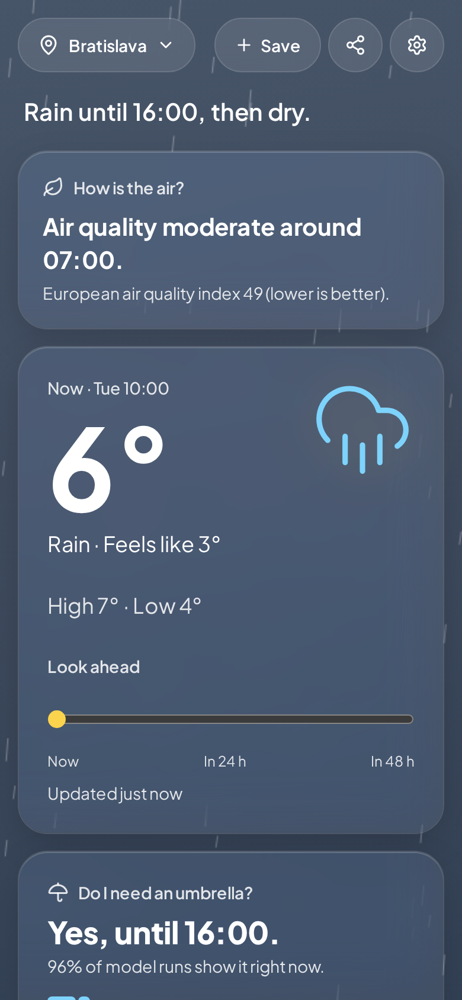
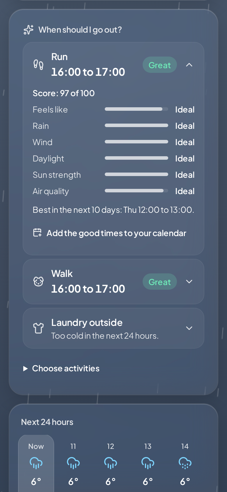
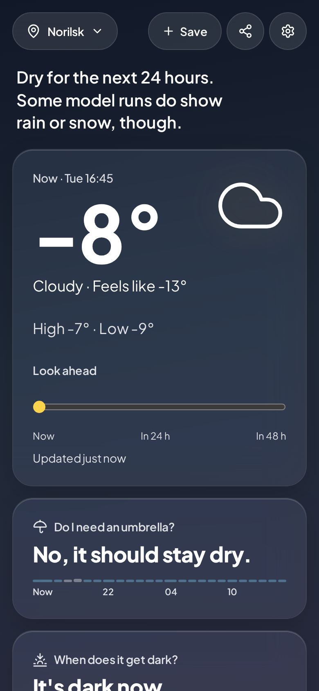
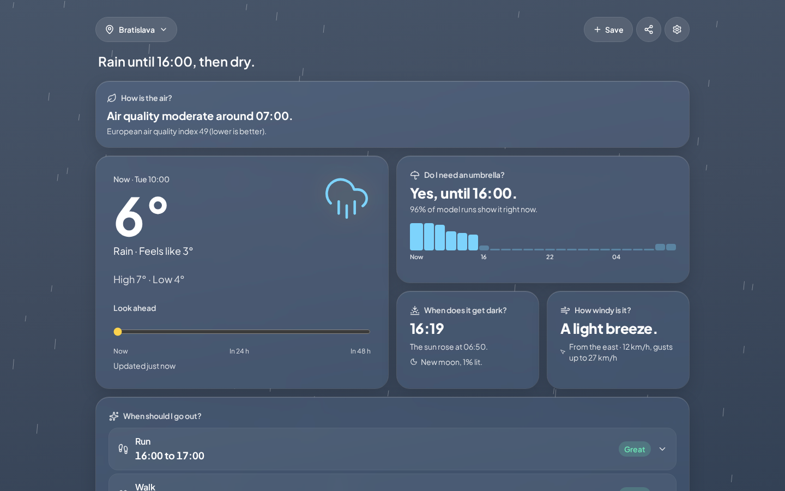
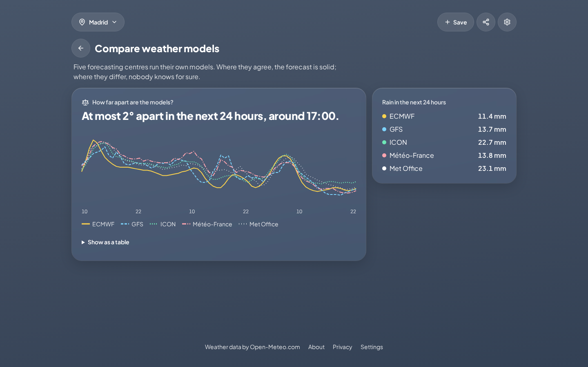

# SkySense

[](https://github.com/AkosKappel/SkySense/actions/workflows/ci.yml)
[](LICENSE)

The weather, made sense of. Most weather apps show a grid of numbers and icons and leave the thinking to you. SkySense answers the questions people actually ask, and says how sure the answer is.

<p align="center">
  
  
  
</p>



## What it answers

- **What is the weather doing?** One or two plain sentences on top ("Rain until 16:00, then dry."), what to wear ("A warm jacket. Something waterproof too."), then tiles that each answer one question: do I need an umbrella, when does it get dark, how windy is it. Today's details add the dew point, visibility and coming fog ("Fog likely until 13:00."). Light and dark themes follow the system unless you pick one.
- **When should I go out?** Every hour is scored for running, cycling, walking, hiking, a picnic, laundry outside, stargazing and golden hour photos. The tile names the best time today and in the next 10 days, or why there is none ("Too wet in the next 24 hours."), each score opens into the factors behind it, and the good times download as a calendar file. A comfort setting shifts the temperatures for people who get cold or warm easily.
- **How sure is it?** 51 runs of the ECMWF ensemble give a likely range around the temperature line, "96% of model runs show it right now" under the umbrella answer, and "Less sure" or "Uncertain" on later days. The summary hedges when the runs disagree. Five weather models can be compared side by side.
- **Is this normal?** Today's high against the 1991 to 2020 climate for the date ("3° colder than usual."), the same date in each of the last ten years, and how long it has been dry ("Dry for 9 days.").
- **Anything else I should know?** Air quality and pollen when they matter, tonight's moon, whether the pressure is rising or falling, strong gusts, frost and heat, and how far the place's clock is from yours.
- **Is rain coming my way?** A radar map of the last 2 hours, then the model's rain for the next 3, said in words too ("The model shows rain within about 60 km from 11:00."). The same map switches to the model's temperature and wind ("Warmer to the south, by about 2°."), shows the other saved places, and opens full screen.
- **Where is the weather better?** For an activity and a day, a map of some 150 km around the place, each 25 km square coloured by the same activity score, and the answer in words: "Better around Győr, 70 km south-east: 14:00 to 16:00, a score of 92 against 76 here." Arrow keys move between squares; Enter or a click opens the forecast there.
- **Which day this week?** A week page: the best day for each chosen activity ("Run: best on Saturday 14 November, 10:00 to 11:00."), then every day as a strip of its hours, temperature and rain, with that day's best times.
- **A map of its own.** `/map` opens both maps full width around the last place, with a place search that stays on the map. A click anywhere on the radar opens the forecast there.
- **Where is it nicer?** Two saved places side by side, day by day, with the nicer one marked.

Mobile first, installable and usable offline for places opened before, with a "My location" entry that finds you again. No accounts, no tracking. In English, German, Slovak, Hungarian and Spanish.



## How it works

- **SvelteKit with TypeScript** (Svelte 5 runes), Tailwind CSS 4, Paraglide JS for the five languages, deployed on Vercel. Why: [docs/decisions](docs/decisions/).
- **The browser only talks to this app.** Server routes call [Open-Meteo](https://open-meteo.com/) (forecast, ensemble, air quality, historical archive), validate the answers with zod and reduce them: 51 ensemble members become three numbers an hour, 30 years of history become deciles for a month. Coordinates are rounded to about 1 km. Answers are cached on the CDN and in memory.
- **The advice is explicit rules, not a model.** Activity scores are weighted geometric means of factors with named thresholds, so one bad factor sinks a score instead of being averaged away. Every threshold and the reason for it is in [decision 0003](docs/decisions/0003-scoring-and-summary-rules.md).
- **Whole sentences per language.** Logic returns a message key and values, never fragments to glue together, and plural forms follow each language (Slovak has three).
- **Tested against recorded weather.** Unit tests, component tests in Chromium and Playwright end-to-end tests on desktop and a phone run against recorded Open-Meteo responses, including polar night, the midnight sun and a heat wave. Every page is checked with axe at 320 px, for keyboard focus and for reduced motion. CI enforces Lighthouse scores and JavaScript budgets.

## Development

Requires Node 24 and pnpm.

```bash
pnpm install
pnpm dev
```

| Command         | What it does                                               |
| --------------- | ---------------------------------------------------------- |
| `pnpm dev`      | Dev server on port 5173                                    |
| `pnpm lint`     | Prettier check and ESLint                                  |
| `pnpm format`   | Format everything with Prettier                            |
| `pnpm check`    | Compile translations, then `svelte-check` (types)          |
| `pnpm test`     | Unit and component tests (Vitest, Chromium for components) |
| `pnpm test:e2e` | Playwright against the production build                    |
| `pnpm build`    | Production build for Vercel                                |

`CARTO_BASEMAP_KEY` (optional, public) is a free [CARTO basemaps key](https://carto.com/basemaps/apikey) for the map under the radar; without it the radar shows on a plain background. `SKYSENSE_FIXTURES=1` makes the server answer from the recorded responses in `src/lib/server/fixtures/`, so the app runs offline with a fixed "now". On a place page, `?demo=heat`, `?demo=polar-night` or `?demo=midnight-sun` shows a recorded scenario. The screenshots above come from `node scripts/render-screenshots.ts` against that mode.

## Embedding

Any place can go on another site as a small card (now, the summary and the umbrella answer, with the attribution):

```html
<iframe
	src="https://skysense.akoskappel.dev/embed/48.15,17.11/Bratislava"
	width="360"
	height="280"
	title="Weather in Bratislava"
></iframe>
```

Only `/embed/` pages allow framing; every other page sends `frame-ancestors 'none'`.

## Wall display

`/wall/48.15,17.11/Bratislava` (linked from each place as "Wall display") is for a tablet or an old phone left on all day: a big clock, now, the day's sentence and the next 12 hours. It reloads every 10 minutes and keeps the last forecast while offline, keeps the screen on with the Screen Wake Lock API, turns dark and dim between sunset and sunrise, and shifts a few pixels every hour against burn-in.

## Data and attribution

Weather data by [Open-Meteo.com](https://open-meteo.com/), licensed under [CC BY 4.0](https://creativecommons.org/licenses/by/4.0/). Historical data from ERA5 (Copernicus Climate Change Service), forecasts from the national weather services' models that Open-Meteo combines.

## License

[MIT](LICENSE)
